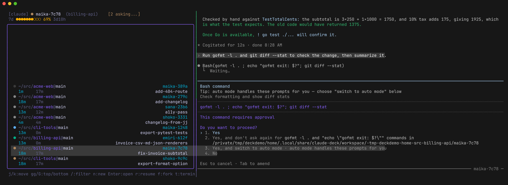

# claude-deck

**Claude Code のセッションを何本も並べて動かすための、ターミナルのダッシュボード。**
どのエージェントがあなたを待っているかが一目で分かり、キー 1 つでそこへ移れる。セッションごとに [jj](https://github.com/jj-vcs/jj) のワークスペースで動かすので、並べたエージェントが互いの作業を上書きしない。TUI のほかに、JSON を返す CLI や Claude Code 自身からも操作できる。

詳しい説明、設定、FAQ は [英語の README](README.md) にある。



## 何ができるか

- **状態が一目で分かる**: 実行中、待機中、サブエージェント実行中、承認待ち、質問待ち、終了。画面から推測せず、Claude Code の hook から取る。
- **`Tab` で、あなたを待っているセッションへ移る**: そのセッションの端末にフォーカスが移る。
- **セッションごとに jj ワークスペース**: 並べたエージェントが互いの変更を上書きしない。`.env` のような追跡外のファイルは symlink で渡せる。
- **終わっても消えない**: ログを読み返し、再開し、フォークできる。claude-deck の外で起動したセッションも一覧に出る。
- **スクリプトから操作できる**: CLI は JSON を返す。同梱のスキルで、Claude Code 自身が別のセッションを立てて閉じられる。

## 始め方

必要なもの: macOS か Linux、Claude Code、tmux、jj、インストールに Go 1.26 以上。Ghostty は任意（あれば画面を自動で分割する）。

```bash
GOEXPERIMENT=jsonv2 go install github.com/pomesaka/claude-deck/cmd/claude-deck@latest

cd your-project
jj git init --colocate   # jj のリポジトリでなければ一度だけ。git はそのまま使える
claude-deck
```

`n` を押してリポジトリを選ぶと、新しい jj ワークスペースで Claude Code が起動する。何本か立て、橙色になったものがあれば `Tab` を押す。

Ghostty 以外の端末では、起動時に表示される `tmux attach-session -t claude-deck` を別のペインで実行する。

`jj git init --colocate` は `.git` の横に `.jj` を足すだけだ。`.jj` は git に無視されるのでチームには届かず、やめるときは `.jj` を消せばよい。

## 作業を取り出す

セッションの変更は、動いている間も閉じた後も、リポジトリのコミットとして残る。ブランチにして PR にするには次のようにする。

```bash
jj log                                  # 動いているセッションの作業には <名前>@ が付く
jj git push --change maika-7c78@        # そのセッションの作業を新しいブランチとして push する
```

## よくある質問

- **git だけのリポジトリでも使える？** 使える。`jj git init --colocate` は既存の `.git` の横に jj を足すだけで、git のコマンドはそのまま動く。ワークスペースを作らずにリポジトリで直接動かすなら、`n` で `Enter` の代わりに `Ctrl+Enter` を押す。
- **Ghostty は必要？** 不要。別のペインで tmux に attach すればよい。
- **Codex CLI は？** `runtime.provider = "codex"` で使える。Codex には hook が無いので、状態は実行中と待機中だけになる。
- **ダッシュボードの文字をコピーしたい** `Shift` を押しながらドラッグする。右ペインだけを矩形で選ぶなら、macOS では `Shift + Option + ドラッグ`。

## ライセンス

[MIT](LICENSE)
