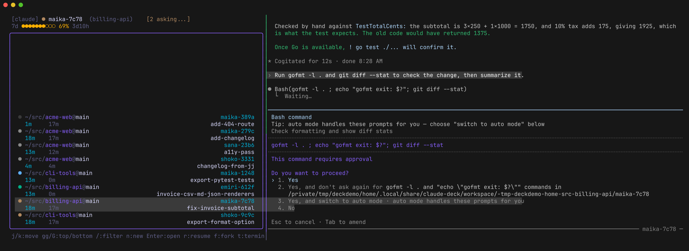
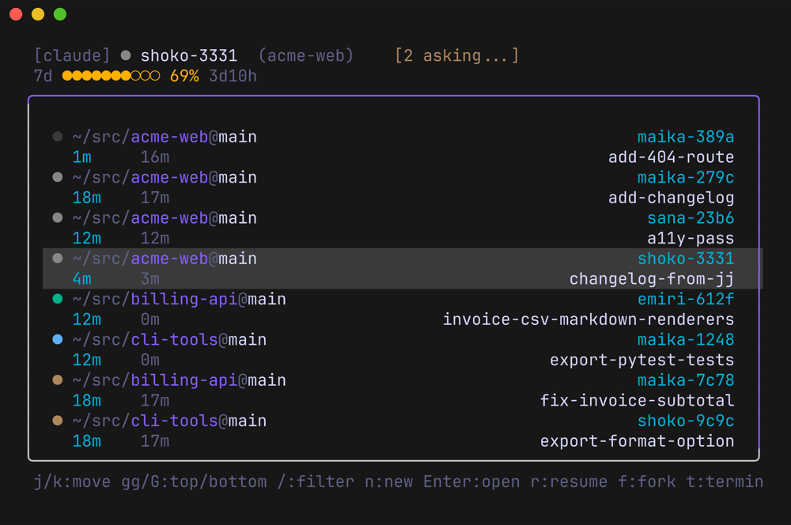
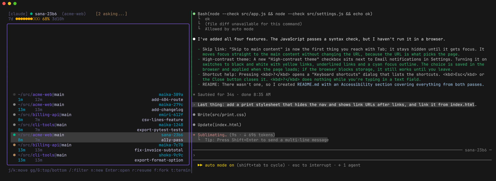
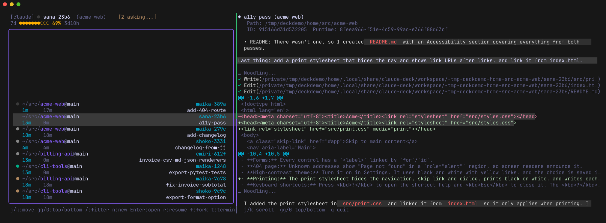
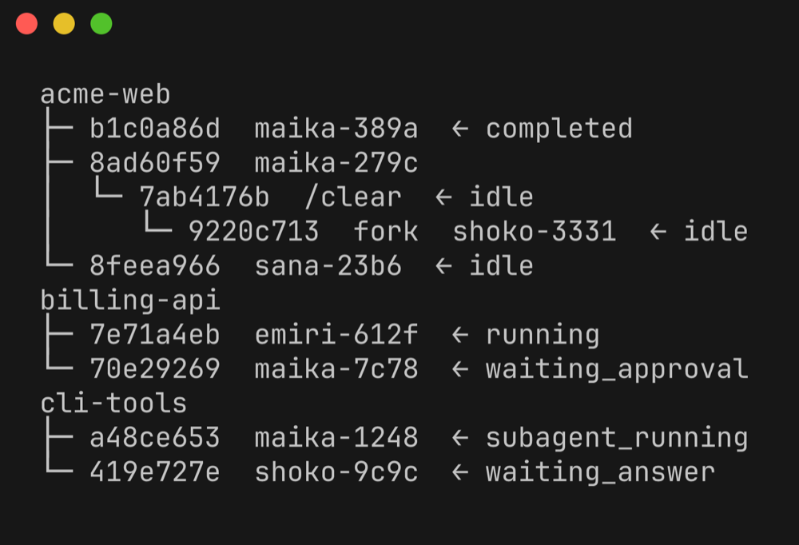

# claude-deck

[](go.mod)
[](LICENSE)

**A terminal dashboard for running many [Claude Code](https://docs.anthropic.com/en/docs/claude-code) sessions at once.**
See which agent is waiting for you and jump to it with one key. Each session works in its own [jj](https://github.com/jj-vcs/jj) workspace, so parallel agents don't overwrite each other's work. Drive it from the TUI, from a JSON CLI, or from Claude Code itself.

[日本語](README.ja.md)



<!-- TODO(readme-demo): docs/assets/demo.gif — Ghostty で左に一覧、右に tmux。4〜5 本が違う色で並ぶ → 1 本が承認待ちに変わりヘッダーが [1 asking...] になる → Tab で右に飛ぶ → 承認する → ● が Running に戻る。12〜15 秒、ループしても不自然でないように -->

## Why claude-deck

Run several Claude Code sessions in terminal tabs or tmux panes, and the same things keep going wrong. claude-deck answers each of them.

- **An agent sits waiting for your approval in a pane you aren't looking at.** Every session shows whether it is running, idle, or waiting for your approval or answer, and `Tab` takes you straight into the next one that needs you.
- **Two agents on the same repository overwrite each other's files.** Each session works in its own jj workspace, created when the session starts. `.env` and other untracked files can be symlinked in.
- **Closing the terminal or the tool that runs your agents stops their work.** Sessions run in tmux, not inside claude-deck. Quit, upgrade or crash the dashboard and they keep working; the list comes back as it was when you start it again.
- **You can't find last week's session, or where its changes went.** Finished sessions stay in the list with their log. Resuming one brings back its files and its conversation, and its changes are commits in your repository.
- **Splitting work across agents means starting and briefing each one by hand.** Sessions started by claude-deck know its CLI through a bundled skill. One session can start others, give each a task, and talk to them through Claude Code's messages between sessions, working as a PM for a few coders. A session that notices a problem outside its own task finds the running session in charge of it and hands it over, without you telling it where to send it. Pin the PM with `p`, and you always know where your small team starts.
- **You'd rather not leave the terminal for yet another app.** claude-deck is a TUI. The list and the live sessions sit side by side in one terminal window, and everything is a key away.

## Quick Start

### Requirements

- macOS or Linux
- [Claude Code](https://docs.anthropic.com/en/docs/claude-code), [tmux](https://github.com/tmux/tmux) and [jj (Jujutsu)](https://github.com/jj-vcs/jj)
- Go 1.26+ to build it — prebuilt binaries are not published yet
- [Ghostty](https://ghostty.org/) (optional) — claude-deck splits the window for you; in other terminals you attach to tmux in a second pane

### Install

```bash
GOEXPERIMENT=jsonv2 go install github.com/pomesaka/claude-deck/cmd/claude-deck@latest
```

`GOEXPERIMENT=jsonv2` is needed because claude-deck uses Go's `encoding/json/v2`.

### First run

```bash
cd your-project
jj git init --colocate   # once, if it is not a jj repository yet
claude-deck
```

Press `n`, pick the repository, and a Claude Code session starts in a fresh jj workspace. Start a few more. When one turns orange, press `Tab`. (`n` offers jj repositories only, hence the `jj git init`.)

Outside Ghostty, run the command claude-deck prints on start (`tmux attach-session -t claude-deck`) in another pane to see the sessions.

### Using it on a git repository you share with others

`jj git init --colocate` adds a `.jj` directory next to `.git` and nothing else:

- Git ignores `.jj` (jj puts a `.gitignore` inside it), so it is never committed and never reaches your teammates.
- `git` keeps working. `git status` shows a detached HEAD, because jj moves HEAD as it records changes; you can still commit, branch and push with git, and jj picks it up.
- Sessions do not create git branches or move `main`. Their work stays in your local repository until you push it.
- To stop using jj, delete `.jj`.

### What it changes on your machine

- A tmux session named `claude-deck`, with one window per Claude Code session.
- Inside Ghostty, a split on the right of the window you started claude-deck in.
- Claude Code is started with a plugin passed by `--plugin-dir`, which reports the status. Your Claude Code settings and hooks are not changed.
- Its data directory and the workspaces it creates are marked as trusted in `~/.claude.json`, so Claude Code does not ask about each workspace. `claude-deck gc` removes the entries of workspaces that are gone.
- The session list and the workspaces live in `~/.local/share/claude-deck` ([details](docs/configuration.md#data-directories)).

claude-deck does not send desktop notifications. The header shows how many sessions are waiting (`[2 asking...]`), and `Tab` takes you to them.

## Features

### Know who's waiting for you

Each session has a colored dot for its status, and the header counts the sessions waiting for you. On a Claude subscription, the header also shows how much of your 5-hour and 7-day limits you have used.



| Dot | Status |
|---|---|
| green | Running |
| blue | Subagents running in the background after the turn ended |
| grey | Idle — finished its turn, waiting for your next prompt |
| orange | Waiting for approval or for an answer |
| dark | Done, or started outside claude-deck |
| red | Error |

Each row shows where the session works and the nearest bookmark (branch) its work sits on (`@main`), its name, how long it has run, and how long ago it last did something. Below the name is a short label for the task (`fix-invoice-subtotal`), which the session gives itself when it knows what it is doing. You can set it with `claude-deck alias`. The name (`maika-7c78`) is fixed; it is also the name of the session's workspace.

### The live session, or its log

Move the cursor and the right pane follows. A running session shows its tmux window, where you work with Claude as usual.



A finished session shows its transcript instead: your prompts, the tools it ran, and the diffs it made.



### One workspace per session

`n` creates a jj workspace named after the session and starts Claude Code in it, so parallel agents work on separate copies of the repository. They can still change the same lines, and then you resolve it when you combine their work, as with branches. `Ctrl+Enter` in `n` starts a session in the repository itself instead.

Untracked files such as `.env` can be symlinked into every new workspace — see [`workspace_symlinks`](docs/configuration.md#workspace-symlinks). Dependencies such as `node_modules` are not shared; install them in the workspace, or symlink them the same way.

### Getting the work back

A session's changes are commits in your repository, whether the session is running or closed. `x` closes a session and removes its workspace after jj has recorded the files it changed, so nothing is lost. To turn a session's work into a branch and a pull request:

```bash
jj log                                  # a running session's work is marked <name>@
jj git push --change maika-7c78@        # push a running session's work as a new branch
jj git push --change <change-id>        # or a closed one's, by the change ID jj log shows
```

`jj git push --change` creates a branch named after the change and pushes it. From there it is an ordinary git branch, ready for a pull request.

### Resume, fork, and trace

`r` resumes a finished session, recreating its workspace where it left off. `f` (or `claude-deck fork`) forks a session into a new one. Claude Code sessions you started yourself, outside claude-deck, appear in the list too; `r` adopts one. `claude-deck tree` shows how your conversations branched through `/clear` and forks; `←` marks the conversation each session continues on resume, with its status.



### Drive it from scripts and from Claude

Every command prints JSON and works without the TUI running, from any shell or agent:

```bash
claude-deck new --dir ~/src/api --prompt "Add retries to the HTTP client"   # start a session on a task
echo "$long_task" | claude-deck new --prompt -    # or read the task from stdin
claude-deck fork --prompt "Measure the cold start"   # fork this session's conversation into a new one
claude-deck list                    # every session, in the order of the list (an array)
claude-deck list --alias invoice    # only sessions whose label contains "invoice"
claude-deck close maika-7c78        # stop it and remove its workspace (ID or name)
```

Every session claude-deck starts also gets the bundled `deck-status:claude-deck` skill, which teaches Claude Code these commands. Ask such a session to "start another session to look into the flaky test" and the new one appears in the list, already working on it.

The `name` a session gets is also its Claude Code session name, so sessions can message each other with SendMessage. Ask one session to act as a PM: it starts a session per task, sends each one its brief, and collects their reports. Pin it with `p` to keep it at the bottom of the list, where you can always find it.

<details>
<summary>Output, statuses, and driving a session from a script</summary>

`new`, `fork`, `close` and `alias` print one session; `list` prints an array of them:

```json
{
  "id": "6423be258795c579",
  "name": "maika-7c78",
  "alias": "fix-invoice-subtotal",
  "repo_path": "/home/you/src/billing-api",
  "work_dir": "/home/you/.local/share/claude-deck/workspace/-home-you-src-billing-api/maika-7c78",
  "status": "waiting_approval",
  "claude_session_id": "70e29269-…",
  "session_chain": ["70e29269-…"]
}
```

`status` is one of `running`, `idle`, `subagent_running`, `waiting_approval`, `waiting_answer`, `completed` and `error`. There is no wait command; poll `list`.

`--prompt` (on `new` and `fork`) gives the session its first task; it stays an interactive session you can talk to afterwards. Without it, the session starts waiting for one.

`new` and `fork` return as soon as the session's tmux window opens, before Claude Code has started on the task, and its `status` is already `idle`. To wait for the task to finish, wait for `running` first, then for `idle` (its turn ended). No command returns the session's last reply; it is in the Claude Code transcript, `~/.claude/projects/*/<claude_session_id>.jsonl`. To keep sessions from stopping for approvals, set [`permission_mode`](docs/configuration.md).

</details>

## What makes it different

- **Status from hooks.** A plugin claude-deck loads into each session reports what Claude Code is doing, so "waiting for approval" and "waiting for an answer" are told apart, and subagents still running after the turn are shown.
- **Sessions don't depend on the dashboard.** Each Claude Code session runs in its own tmux window, not as a child of claude-deck, and its hooks write the status to claude-deck's database directly. When the TUI starts, it matches the database against the tmux windows and shows every session as it is.
- **Workspaces that keep their changes.** jj records the files a session changed on its own, so closing a session never throws away uncommitted work, and resuming it brings the files back.
- **Finished sessions stay.** They keep their log in the list and can be resumed or forked, until the oldest are pruned past `max_sessions` (30 by default).

## Keybindings

| Key | Action |
|-----|--------|
| `j/k` | Move cursor |
| `gg/G` | Jump to top/bottom |
| `Enter` | Focus the session's tmux window / resume a finished session |
| Click | Select the session; clicking the selected one does what `Enter` does |
| `n` | New session (Enter: with workspace, Ctrl+Enter: direct) |
| `r` | Resume session |
| `f` | Fork session |
| `x` | Kill the process and remove its workspace (JSONL and metadata are kept) |
| `p` | Pin / unpin the session (pinned sessions stay together at the bottom of the list) |
| `t` | Open Ghostty terminal |
| `/` | Filter sessions (`Esc` clears the filter) |
| `Tab` | Jump to next session needing attention |
| `R` | Redraw |
| `?` | Show help |
| `Ctrl+C` | Quit (asks first) |
| `Ctrl+Z` | Quit without asking |

`f` and `t` can be rebound with `[keybinds]` (`fork`, `open_term`). The other keys are fixed.

## Configuration

Everything is optional. The config file is `~/.config/claude-deck/config.toml`. The settings people change first:

```toml
[defaults]
permission_mode = "plan"            # passed to every session as --permission-mode

[discovery]
project_markers = ["go.mod", "package.json"]   # offer subprojects of a monorepo in `n`

[projects."/Users/you/your-repo"]
workspace_symlinks = [".env"]       # symlink untracked files into each workspace
```

Every setting, the data directory, and Codex support: [docs/configuration.md](docs/configuration.md).

## FAQ

### Do I need Ghostty?

No. Inside Ghostty, claude-deck splits the window and attaches the right pane to its tmux session. In any other terminal, open a second pane and run `tmux attach-session -t claude-deck`.

### Does it work with Codex CLI?

Partly, with `runtime.provider = "codex"`. Codex has no hooks, so only running and idle are shown, never waiting for approval or an answer. See [docs/configuration.md](docs/configuration.md#runtime-provider).

### How do I copy text from the dashboard?

Hold `Shift` while dragging to use your terminal's own selection. For a block selection inside the right pane, use `Shift + Option + drag` on macOS (`Shift + Ctrl + Alt + drag` on Linux). This is how it works in Ghostty; other terminals may differ.

## Development

```bash
GOEXPERIMENT=jsonv2 go build -o claude-deck ./cmd/claude-deck
GOEXPERIMENT=jsonv2 go test ./...
```

Design notes are in [docs/](docs/) (Japanese). Start with [docs/01-overview.md](docs/01-overview.md).

## License

[MIT](LICENSE)
